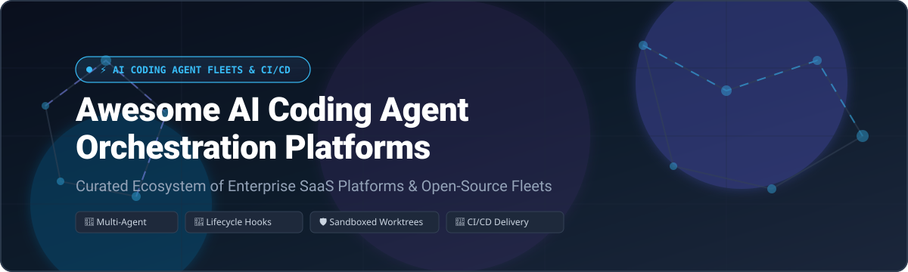

# 🤖 Awesome AI Coding Agent Orchestration 🚀

### *The Definitive Curated List of Enterprise SaaS Platforms, Agentic Fleets, and Open-Source Frameworks*

**Explore the modern ecosystem of Agent Fleets, Lifecycle Hooks, Multi-Agent Swarms, Sandboxed Worktrees, CI/CD Delivery, and Automated Quality Gates.**

📅 *Last updated: October 2026*

---

## 📖 Table of Contents

- [🌟 Introduction & Vision](#-introduction--vision)
- [📊 Sector Overview & Market Dynamics](#-sector-overview--market-dynamics)
- [💼 Enterprise SaaS Platforms](#-enterprise-saas-platforms)
- [💻 Open-Source GitHub Projects](#-open-source-github-projects)
- [⚙️ Architectural Orchestration Patterns](#️-architectural-orchestration-patterns)
- [🤝 How to Contribute](#-how-to-contribute)
- [💖 Support & Sponsorship](#-support--sponsorship)
- [📈 Star History](#-star-history)
- [⚠️ Disclaimer](#️-disclaimer)

---

## 🌟 Introduction & Vision

This repository tracks notable **enterprise SaaS delivery platforms** and **open-source orchestrators** designed for **AI Coding Agent Orchestration**. As autonomous coding agents transition from single-prompt copilots to full-fledged autonomous engineers, orchestrating fleets of agents requires:

- 🛡️ **Isolation & Sandboxing**: Dedicated Git worktrees, ephemeral container environments, and micro-VMs.
- 🔄 **Lifecycle Hooks & Skills**: Pre-execution checks, lint/test evaluation gates, and human-in-the-loop review checkpoints.
- 🎯 **Campaign Persistence**: Resumable multi-step developer missions that survive failures and token limits.
- 🚀 **Production CI/CD Integration**: Seamless delivery into existing developer pipelines, PR bots, and deployment engines.

Contributions are welcome! Submit a PR to add or update projects.

---

## 📊 Sector Overview & Market Dynamics

The global AI coding agent and agentic software development market is estimated at **$7.4B–$10.7B in 2025** and projected to surge to **$9.1B–$14.6B in 2026**, expanding at an aggressive 25–35% CAGR toward a $50B+ valuation by 2030.

The sector exhibits a distinct **bifurcated market structure**:
1. 🏛️ **Foundational Infrastructure Layer (Highly Concentrated)**: Core LLM intelligence and cloud compute runtimes are concentrated among hyperscalers (Microsoft/GitHub, Alphabet/Google, Amazon/AWS) and leading frontier AI labs.
2. 🧩 **Agentic Harness & Tooling Layer (Moderately to Highly Fragmented)**: The orchestration plane, developer interfaces (terminal agents, AI-native IDEs), and multi-agent coordination frameworks are rapidly fragmenting across startups and open-source ecosystems, with engineering teams routinely combining complementary tools rather than settling on a single monolithic vendor.

---

## 💼 Enterprise SaaS Platforms

The following table benchmarks commercial SaaS platforms and enterprise pipelines that govern, trigger, and orchestrate AI coding agents, **sorted in descending order by company size (valuation / market capitalization)**:

| 🏢 Platform | 💰 Company Size (Valuation / Revenue) | 🏷️ Starting Tier Pricing | 🎁 Free Tier Limits | 📝 Description |
| :--- | :--- | :--- | :--- | :--- |
| **[Microsoft / GitHub Actions](https://github.com/features/actions)** | ~$3.1T Market Cap (Parent: Microsoft) | $4/user/month (Team plan) | **2,000 build minutes/month** and 500 MB GitHub Packages storage for public and private repositories (unlimited for public repos) | 🐙 Native CI/CD and automation on GitHub; widely used to run coding agents, PR bots, and multi-step AI workflows on repository events. |
| **[Azure DevOps](https://azure.microsoft.com/en-us/products/devops)** | ~$3.1T Market Cap (Parent: Microsoft) | $6/user/month (Basic plan, first 5 users free) | **1,800 free build minutes/month** (1 Microsoft-hosted job) + 1 self-hosted job with unlimited minutes; 5 free Basic user licenses and 2 GB artifact storage | ☁️ Microsoft’s pipelines, boards, and repos platform; commonly used to schedule, govern, and orchestrate enterprise AI coding agent workloads. |
| **[Bitbucket Pipelines](https://bitbucket.org/product/features/pipelines)** | ~$45B Market Cap (Parent: Atlassian) | $3/user/month (Standard plan) | **50 build minutes/month**, up to 5 user seats, 1 GB Git repository/LFS storage, and up to 10 concurrent pipeline steps | 🪣 Atlassian’s CI/CD offering integrated with Bitbucket repositories for running automated, review, and agent-based workflows. |
| **[GitLab AI / GitLab CI](https://about.gitlab.com/)** | ~$8.2B Market Cap (NASDAQ: GTLB) | $29/user/month (Premium tier, billed annually) | **400 compute minutes/month**, 5 GB storage, 10 GB transfer/month, and up to 5 user seats per namespace | 🦊 Integrated DevSecOps platform combining pipelines, AI features, and merge-request workflows that host and trigger coding agents. |
| **[Harness](https://www.harness.io/)** | $5.5B Valuation (Series E, Dec 2025) | Contact Sales / Custom (Essentials bundle; add-on modules typically ~$100–$300/service/month) | **2,000 free Harness Cloud credits/month** (resets monthly) for CI/CD stages, open-source GitOps, and basic security testing | ⚡ Modern software delivery platform with CI/CD, feature flags, and AI-assisted orchestration capabilities for pipelines and agent fleets. |
| **[TeamCity Cloud](https://www.jetbrains.com/teamcity/)** | ~$3B–$5B Implied Valuation (~$710M Revenue, JetBrains) | $45/month (Base subscription, includes first 3 committers; +$15/committer/month) | **14-day free trial** with **12,000 build credits** (up to ~20 build hours on Linux Small) and unlimited committer slots during trial | 🏰 JetBrains CI/CD cloud platform used to orchestrate complex builds, test runners, and agent-driven workflow steps. |
| **[CircleCI](https://circleci.com/)** | $1.7B Valuation (Series F) | $15/month (Performance tier, includes 3 active users and 30,000 credits) | **30,000 build credits/month** (approx. 3,000 minutes on Linux Medium / 6,000 on Linux Small), up to 5 active users | ⭕ Cloud CI/CD platform that teams extend with autonomous AI coding agents and automated quality/repair jobs in pipelines. |
| **[CloudBees / Jenkins Enterprise](https://www.cloudbees.com/)** | ~$1.0B Valuation (Series F, >$150M ARR) | $30/month (Platform Team tier) | **2,000 execution minutes/month**, up to 5 user seats, 1 Jenkins controller integration, and 7-day log retention | 🐝 Enterprise distribution and orchestration platform for Jenkins at scale, extended with AI-assisted delivery workflows. |
| **[Octopus Deploy](https://octopus.com/)** | ~$600M+ Valuation (Insight Partners, >$83M ARR) | $2,080/year (Professional tier base package, billed annually) | **Forever-free plan capped at 10 projects, 10 deployment targets/machines, 10 tenants, and 10 users** | 🐙 Deployment automation platform focused on release orchestration and governance downstream of agent-produced artifacts. |
| **[Codefresh](https://codefresh.io/)** | ~$40M–$50M Acquisition Valuation (Octopus Deploy) | $99/month (Starter / Pro tier) | **Freemium plan with 1 concurrent build**, up to 120 builds/month, and community GitOps dashboard support | 🌿 Kubernetes-native CI/CD and GitOps platform (now part of Octopus Deploy) used to orchestrate containerized pipelines with AI agents. |

---

## 💻 Open-Source GitHub Projects

The following open-source frameworks, autonomous coding agents, and harness runtimes empower engineers to coordinate coding agent fleets without vendor lock-in. **Sorted in descending order by GitHub Stars_Count**:

- **[OpenCode](https://github.com/anomalyco/opencode)**   
  🖥️ Open-source coding agent with terminal and desktop surfaces that can be driven as part of larger multi-agent orchestration setups.

- **[OpenHands](https://github.com/All-Hands-AI/OpenHands)**   
  🙌 Autonomous AI software development platform capable of planning, coding, debugging, executing commands, and opening PRs end-to-end.

- **[Daytona](https://github.com/daytonaio/daytona)**   
  🏎️ Open-source developer environment orchestrator providing ephemeral, secure workspace management for autonomous AI coding agents.

- **[MetaGPT](https://github.com/geekan/MetaGPT)**   
  🌟 Multi-agent orchestration framework simulating a full software company by assigning distinct SOPs to Product Managers, Architects, and Engineers.

- **[Cline](https://github.com/cline/cline)**   
  🤖 Autonomous coding agent extension and CLI with execute, browser, and tool capabilities suitable for scheduled agent runs.

- **[AutoGen](https://github.com/microsoft/autogen)**   
  🧩 Multi-agent conversation and orchestration framework from Microsoft enabling complex collaborative workflows and code generation.

- **[CrewAI](https://github.com/crewAIInc/crewAI)**   
  👥 Framework for orchestrating role-playing autonomous AI agents into collaborative crews for multi-step software tasks.

- **[Aider](https://github.com/Aider-AI/aider)**   
  ⌨️ AI pair programming directly in your terminal, orchestratable via scripts or CI for repeated, scoped coding tasks.

- **[LangGraph](https://github.com/langchain-ai/langgraph)**   
  🕸️ Library for building resilient multi-agent and stateful agentic workflows with cyclical graph support and human-in-the-loop control.

- **[Continue](https://github.com/continuedev/continue)**   
  ⏩ Open-source AI code assistant providing extension and headless interfaces for developer workflows and custom agents.

- **[Prefect](https://github.com/PrefectHQ/prefect)**   
  🐍 Workflow orchestration engine in Python used to schedule, monitor, and retry agentic coding campaigns and fleets.

- **[Temporal](https://github.com/temporalio/temporal)**   
  ⏳ Durable workflow and execution engine frequently used as the fault-tolerant control plane for long-running agent campaigns.

- **[SWE-agent](https://github.com/SWE-agent/SWE-agent)**   
  🧪 Autonomous software engineering agent designed to solve GitHub issues end-to-end, typically orchestrated in batch campaigns.

- **[Argo Workflows](https://github.com/argoproj/argo-workflows)**   
  ☸️ Kubernetes-native workflow engine used to run, isolate, and deploy agent-produced software changes at scale.

- **[E2B](https://github.com/e2b-dev/E2B)**   
  📦 Open-source secure sandboxed execution environments for AI coding agents and code interpreters.

- **[Citadel](https://github.com/SethGammon/Citadel)**   
  🏰 Agent orchestration harness for Claude Code and Codex with lifecycle hooks, skills, campaign persistence, and parallel worktrees.

---

## ⚙️ Architectural Orchestration Patterns

Organizations scaling AI coding agents typically adopt one or more architectural patterns:

- 🏗️ **Fleet & Lifecycle Harness**: Run harnesses like **Citadel** or **OpenHands** on top of foundation models (Claude Code, OpenAI Codex) to enforce pre-commit linters, post-execution tests, and shared knowledge bases.
- 👥 **Role-Based Multi-Agent Swarms**: Structure agents by domain specialization (e.g., using **MetaGPT** or **CrewAI**) where distinct agents act as product owners, architects, reviewers, and implementers.
- 🔒 **Sandboxed Execution Runtimes**: Utilize micro-VM containers with **Daytona** or **E2B** to grant coding agents safe terminal and file access without risking host corruption.
- 🔄 **Durable State Orchestration**: Leverage **Temporal** or **Prefect** to manage long-lived multi-day campaigns, auto-retrying failed API calls and synchronizing human feedback.
- 🚢 **CI/CD Delivery Pipelines**: Connect automated agent output directly into **GitHub Actions**, **GitLab CI**, or **Harness** for automatic pull request validation and deployment verification.

---

## 🤝 How to Contribute

Contributions are warmly welcomed! Please follow these steps to contribute:

1. 🍴 **Fork** this repository.
2. 📝 **Add or edit** entries in [`README.md`](file:///README.md) adhering to the existing formatting and table layout.
3. 🔍 **Verify details**: Ensure descriptions are concise (1–2 sentences) and include exact pricing/free tier parameters (for SaaS) or social badges (for OSS).
4. 🚀 **Submit a Pull Request** with a descriptive summary of your changes.

---

## 💖 Support & Sponsorship

If you find this curated list valuable for your engineering workflows or research, please consider supporting the project:

- ⭐ **Star** this repository on GitHub to boost visibility!
- 🍴 **Fork** and share it with your developer community and platform teams.
- ☕ **Buy a coffee & sponsor**: If you'd like to support ongoing curation and development, check out the [GitHub Sponsor Dashboard](https://github.com/sponsors/ishandutta2007)! Every contribution is deeply appreciated.

---

## 📈 Star History

---

## ⚠️ Disclaimer

- This is an open **community-curated** catalog — listings do not imply commercial endorsement.
- Autonomous coding agents execute code and manipulate environments. Always enforce proper sandboxing, human authorization gates, and branch protections before deploying agent workflows into production repositories.

---

Crafted with care for platform engineers, AI researchers, and agent architects worldwide. 🌍

